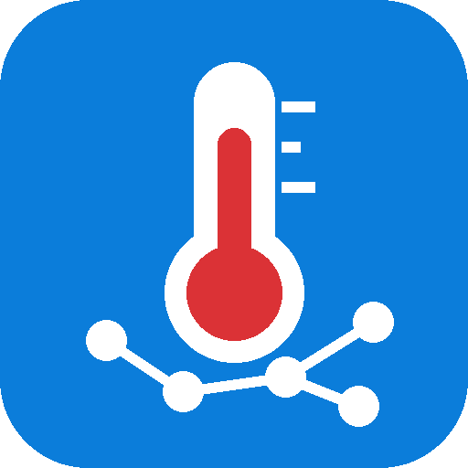
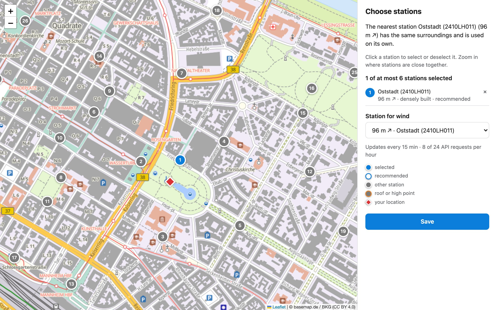

# Klimamessnetz Mannheim for Home Assistant

[Deutsch](README.md) · **English** · [Documentation](https://codebrauer.github.io/ha-mannheim-climate/)

Climate values for your location from the dense urban climate network of
[Smart City Mannheim](https://smartmannheim.de/) (400+ stations): temperature, humidity,
dew point, absolute humidity, apparent temperature, air pressure, global irradiance and wind.

The integration picks the station that represents your place best. If the nearest one does
not fit (too far away, different surroundings, mounted on a roof), it combines several
stations around you instead.

> Unofficial project. Not affiliated with Smart City Mannheim GmbH or the city of Mannheim.

## Features

- **Station recommendation** based on distance, surroundings (Local Climate Zones) and
  mounting height; accept it with one click or choose yourself on the **interactive map**.
- **One station or a combination**: the median of several stations, outliers removed.
- **Sensors and a weather entity** with all current values, plus diagnostic sensors.
- **Respects the API limits** with a shared request budget and cache for all locations.
- **Several locations** (home, work, ...), each as its own device.
- **Repairs** when a station fails, and **suggestions** when new stations are added nearby.
- English and German.

## Installation

### HACS (custom repository)

Or manually:

1. HACS → ⋮ → *Custom repositories* → add `https://github.com/CodeBrauer/ha-mannheim-climate`
   with type *Integration*.
2. Install *Klimamessnetz Mannheim* and restart Home Assistant.

### Manual

Copy `custom_components/mannheim_climate` into your `config/custom_components/` folder and
restart Home Assistant.

## Setup

*Settings → Devices & services → Add integration → Klimamessnetz Mannheim*

Pick the location on the map, confirm the surroundings and accept the recommended stations.
[Setup](https://codebrauer.github.io/ha-mannheim-climate/user/setup/) in the documentation
explains all steps and options.

## Documentation

| Page | Content |
|---|---|
| [Entities](https://codebrauer.github.io/ha-mannheim-climate/user/entities/) | What each sensor measures and how the weather entity estimates its condition |
| [Station recommendation](https://codebrauer.github.io/ha-mannheim-climate/user/stations/) | Which stations are recommended and why, new stations |
| [API limits](https://codebrauer.github.io/ha-mannheim-climate/user/api-limits/) | How many stations fit; limit shared with the *Smart City Mannheim* integration |
| [Repairs and troubleshooting](https://codebrauer.github.io/ha-mannheim-climate/user/troubleshooting/) | Failed stations, API outages, messages, diagnostics |
| [Developer guide](https://codebrauer.github.io/ha-mannheim-climate/developer/architecture/) | Architecture, flows, contributing |
| [Data sources and licences](https://codebrauer.github.io/ha-mannheim-climate/data-sources/) | Origin and licences of the data |

## Support

If you like the integration, you can buy me a beer:

## License

MIT, see [LICENSE](LICENSE).
