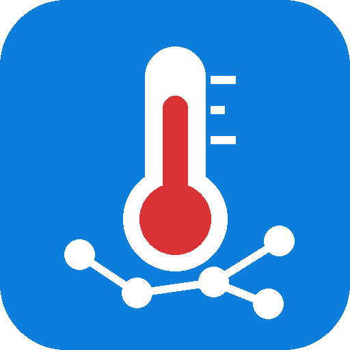
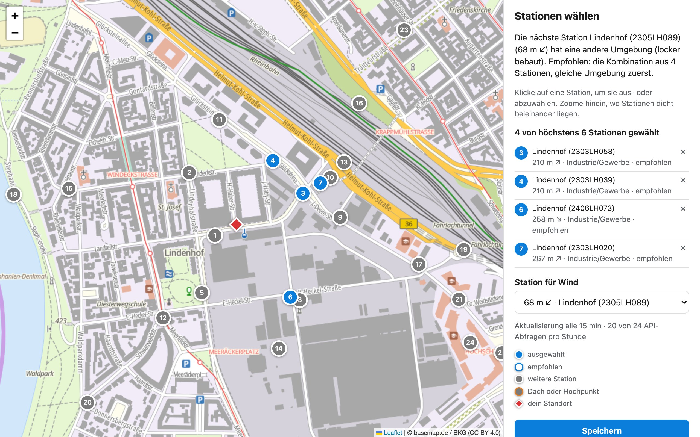
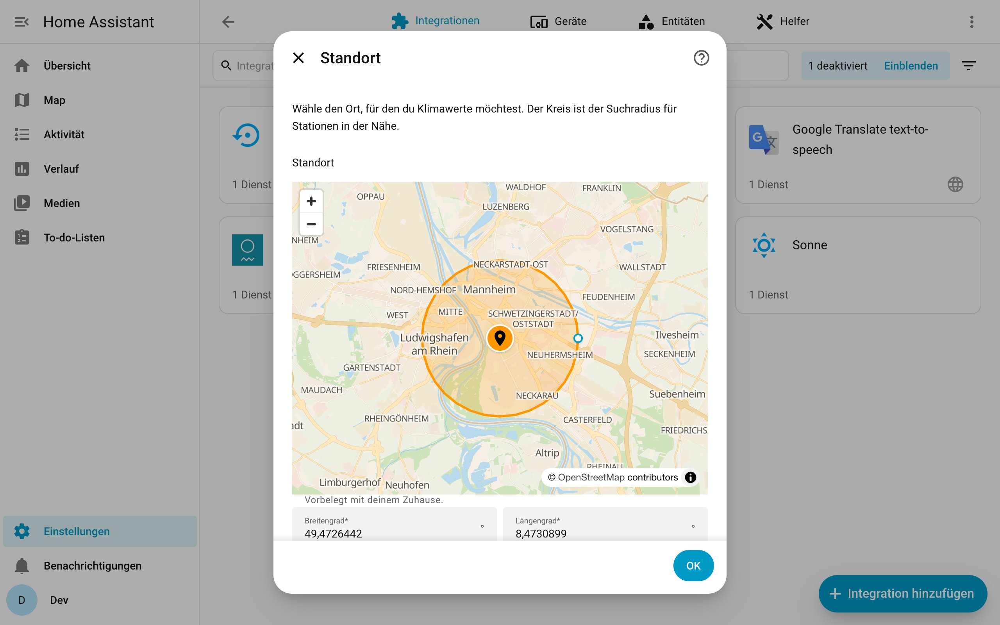
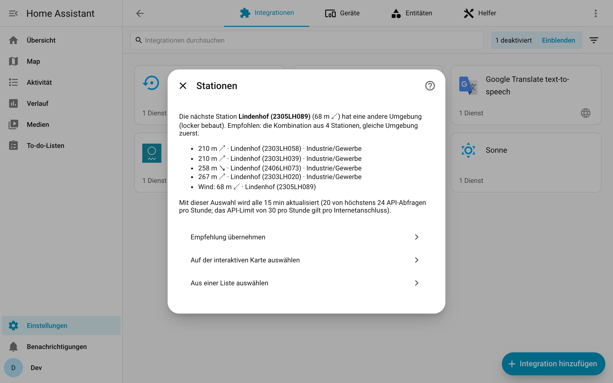
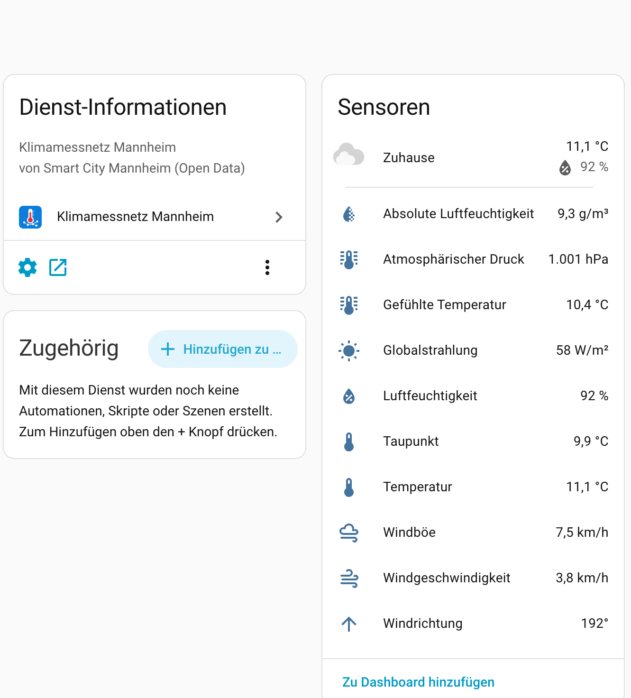
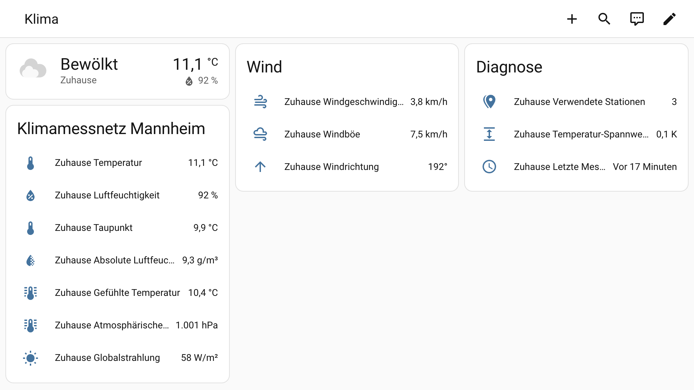

# Klimamessnetz Mannheim für Home Assistant

**Deutsch** · [English](README.en.md)

Klimawerte für deinen Standort aus dem dichten Stadtklima-Messnetz von
[Smart City Mannheim](https://smartmannheim.de/) (über 400 Stationen): Temperatur,
Luftfeuchte, Taupunkt, absolute Feuchte, gefühlte Temperatur, Luftdruck, Globalstrahlung
und Wind.

Die Integration wählt die Station, die deinen Ort am besten abbildet. Passt die nächste
nicht (zu weit weg, andere Umgebung, auf einem Dach montiert), kombiniert sie stattdessen
mehrere Stationen um dich herum.

> Inoffizielles Projekt, nicht verbunden mit der Smart City Mannheim GmbH oder der Stadt
> Mannheim.

<p align="center"></p>

## Funktionen

- **Standort auf der Karte**, vorbelegt mit deinem Zuhause aus Home Assistant.
- **Stationsempfehlung** nach Entfernung, Umgebung (lokale Klimazonen) und Montagehöhe,
  mit einem Klick übernehmen oder selbst wählen.
- **Interaktive Stationskarte**: zoomen, Stationen anklicken, Windstation wählen. Die Karte
  lässt nur so viele Stationen zu, wie ins API-Budget passen, und zeigt das resultierende
  Aktualisierungsintervall live an.
- **Eine Station oder eine Kombination**: Median mehrerer Stationen ohne Ausreißer; die
  Luftfeuchte wird über den Median-Taupunkt berechnet.
- **Sensoren**: Temperatur, Luftfeuchte, Taupunkt, absolute Feuchte, gefühlte Temperatur,
  Luftdruck\*, Globalstrahlung\*, Windgeschwindigkeit, Böe und Windrichtung (\*wenn die
  gewählten Stationen sie messen), dazu Diagnose-Sensoren (verwendete Stationen,
  Temperatur-Spannweite, letzte Messung).
- **Wetter-Entität** mit allen aktuellen Werten. Der Zustand (sonnig / teilweise bewölkt /
  bewölkt) wird tagsüber aus der Globalstrahlung geschätzt, wenn mindestens 3 Stationen sie
  liefern. Das Netz hat keine Wolken- oder Regensensoren, nachts bleibt der Zustand daher
  unbekannt.
- **Hält die API-Limits ein** (gemeinsames Abfrage-Budget und Cache für alle Standorte).
- **Mehrere Standorte** (Zuhause, Arbeit, …), jeder als eigenes Gerät.
- **Reparaturhinweise**, wenn eine gewählte Station keine Daten mehr liefert oder
  verschwindet.
- **Neu konfigurieren**, um einen Standort zu verschieben, **Optionen** für Stationen,
  Aktualisierungsintervall und eine Taupunkt-Korrektur.
- **Diagnose-Download** (Koordinaten geschwärzt).
- Deutsch und Englisch.

## Installation

### HACS (benutzerdefiniertes Repository)

1. HACS → ⋮ → *Benutzerdefinierte Repositories* →
   `https://github.com/CodeBrauer/ha-mannheim-climate` mit Typ *Integration* hinzufügen.
2. *Klimamessnetz Mannheim* installieren und Home Assistant neu starten.

### Manuell

`custom_components/mannheim_climate` in deinen Ordner `config/custom_components/`
kopieren und Home Assistant neu starten.

## Einrichtung

*Einstellungen → Geräte & Dienste → Integration hinzufügen → Klimamessnetz Mannheim*

1. **Standort**: Pin verschieben, der Kreis ist der Suchradius.
2. **Umgebung**: Wie ist die Gegend um den Standort bebaut? Vorausgewählt aus der Karte
   der lokalen Klimazonen.
3. **Stationen**: Die Empfehlung wird begründet angezeigt. Du kannst sie übernehmen, auf
   der interaktiven Karte selbst wählen (öffnet sich in einem neuen Fenster, nach dem
   Speichern geht die Einrichtung automatisch weiter) oder aus einer Liste wählen.

| Standort | Stationen |
|---|---|
|  |  |
| **Gerät mit Sensoren** | **Dashboard** |
|  |  |

Später änderst du Stationen, Intervall und Taupunkt-Korrektur unter *Konfigurieren*. Die
interaktive Karte erreichst du dort über *Neu konfigurieren* (Home Assistant zeigt externe
Fenster in Options-Dialogen nicht zuverlässig an).

### So entsteht die Empfehlung

- Stationen auf Dächern oder Hochpunkten werden für die Temperatur nicht empfohlen.
- Ist die nächste Station im Straßenraum höchstens 1 km entfernt und hat dieselbe
  Umgebung, wird sie allein verwendet.
- Sonst werden bis zu 4 Stationen im Suchradius kombiniert, Stationen mit gleicher
  Umgebung zuerst.

Die Umgebung wird aus lokalen Klimazonen (LCZ) gruppiert: dicht bebaut (LCZ 1–3), locker
bebaut (4–6, 9), Industrie/Gewerbe (7, 8, 10) und grün/offen (11–17). Die Zone einer
Station stammt, wo vorhanden, aus dem Metadatenkatalog der Stadt, sonst aus der globalen
LCZ-Karte.

## API-Limits

Die [Klima-API](https://api.smartmannheim.de/doc) ist öffentlich und braucht keinen
Schlüssel. Dokumentiert sind **30 Messwert-Abfragen pro Stunde und Internetanschluss**
(plus wenige Abfragen der Stationsliste). In der Praxis begrenzt die API zusätzlich kurze
Bursts (etwa 5 Abfragen pro 2 Minuten) und antwortet mit `429` und `Retry-After`.

Die Integration

- lädt die Stationsliste höchstens einmal am Tag und speichert sie lokal,
- speichert Messwerte 9 Minuten zwischen und teilt sie zwischen Standorten,
- sendet höchstens 4 Abfragen pro 2 Minuten und 30 pro Stunde und holt übersprungene
  Stationen kurz danach nach,
- plant für alle Standorte zusammen höchstens 24 Abfragen pro Stunde und wählt das
  Aktualisierungsintervall entsprechend (Standard 15 Minuten; neue Werte kommen ohnehin
  nur alle 10 Minuten mit 10–20 Minuten Verzögerung).

Andere Skripte oder Geräte, die die API über denselben Internetanschluss nutzen, teilen
sich das Limit.

## Datenquellen und Lizenzen

| Daten | Quelle | Lizenz |
|---|---|---|
| Messwerte, Stationsliste | [Klima-API Smart City Mannheim](https://opendata.smartmannheim.de/dataset/klimadaten-echtzeit-api) | dl-de/by-2-0 |
| Standort-Metadaten der Stationen | [Metadatenkatalog Stadtklimamessnetze Mannheim](https://opendata.smartmannheim.de/dataset/metadaten-stadtklimamessnetze-mannheim) | dl-de/by-2-0 |
| Lokale Klimazonen | Demuzere et al. (2022), [Global map of LCZ](https://doi.org/10.5281/zenodo.6364594) | CC BY 4.0 |
| Stadtteilnamen | © OpenStreetMap-Mitwirkende über Nominatim | ODbL 1.0 |
| Kartenkacheln der Stationskarte | [basemap.de](https://basemap.de/) / BKG | CC BY 4.0 |
| Kartenbibliothek (mitgeliefert) | [Leaflet 1.9.4](https://leafletjs.com/) | BSD-2-Clause |

Die statischen Referenzdateien in `custom_components/mannheim_climate/data/` erzeugt
`scripts/build_reference_data.py` (Quelle und Datum stehen jeweils im Feld `source`).

## Entwicklung

```bash
scripts/setup      # legt .venv mit Home Assistant an (uv)
scripts/develop    # startet Home Assistant auf http://localhost:8123 mit dieser Integration
scripts/lint       # ruff format + check
```

Auf macOS gibt es für einige Abhängigkeiten von Home Assistant (`pymicro-vad`,
`pyspeex-noise`) keine Wheels für Python 3.14, und der Build scheitert. Einmal mit
SDK-Pfad bauen:

```bash
SDK=$(xcrun --show-sdk-path) SDKROOT="$SDK" CXXFLAGS="-isysroot $SDK -I$SDK/usr/include/c++/v1" uv pip install --python .venv/bin/python pymicro-vad pyspeex-noise
```

Referenzdaten neu erzeugen (selten nötig, z. B. nach einem neuen Metadatenkatalog):

```bash
uv run --no-project --with openpyxl --with rasterio python scripts/build_reference_data.py
```

## Lizenz

MIT, siehe [LICENSE](LICENSE).
