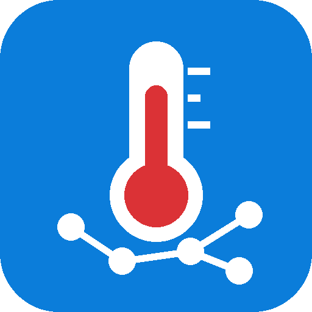
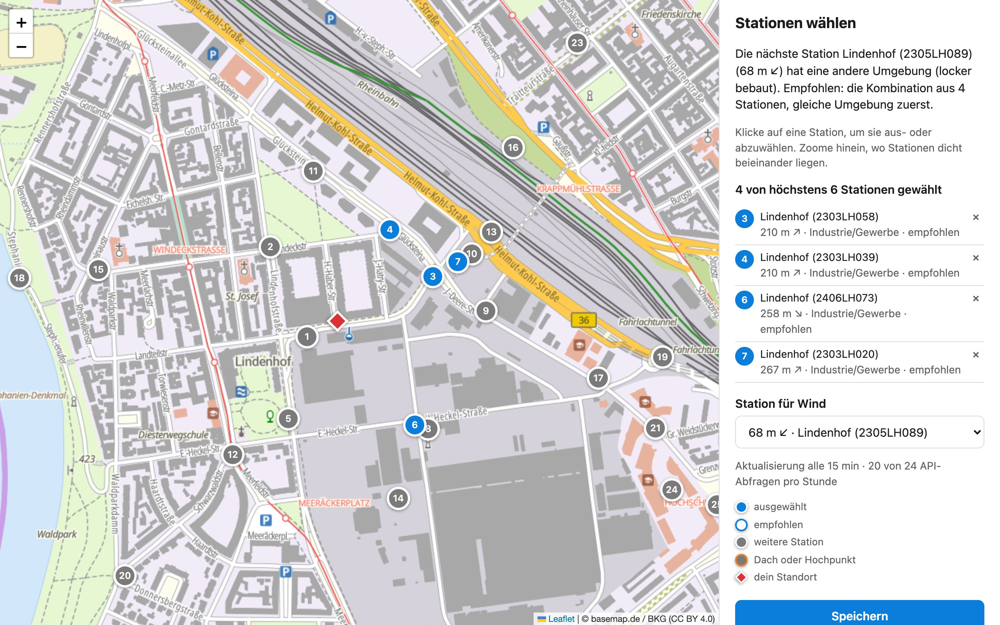

# Klimamessnetz Mannheim für Home Assistant

**Deutsch** · [English](README.en.md) · [Dokumentation](https://codebrauer.github.io/ha-mannheim-climate/de/)

Klimawerte für deinen Standort aus dem dichten Stadtklima-Messnetz von
[Smart City Mannheim](https://smartmannheim.de/) (über 400 Stationen): Temperatur,
Luftfeuchte, Taupunkt, absolute Feuchte, gefühlte Temperatur, Luftdruck, Globalstrahlung
und Wind.

Die Integration wählt die Station, die deinen Ort am besten abbildet. Passt die nächste
nicht (zu weit weg, andere Umgebung, auf einem Dach montiert), kombiniert sie stattdessen
mehrere Stationen um dich herum.

> Inoffizielles Projekt, nicht verbunden mit der Smart City Mannheim GmbH oder der Stadt
> Mannheim.

## Funktionen

- **Stationsempfehlung** nach Entfernung, Umgebung (lokale Klimazonen) und Montagehöhe,
  mit einem Klick übernehmen oder auf der **interaktiven Karte** selbst wählen.
- **Eine Station oder eine Kombination**: Median mehrerer Stationen ohne Ausreißer.
- **Sensoren und Wetter-Entität** mit allen aktuellen Werten, dazu Diagnose-Sensoren.
- **Hält die API-Limits ein**, mit gemeinsamem Abfrage-Budget und Cache für alle Standorte.
- **Mehrere Standorte** (Zuhause, Arbeit, …), jeder als eigenes Gerät.
- **Reparaturhinweise**, wenn eine Station ausfällt, und **Vorschläge**, wenn neue
  Stationen in der Nähe hinzukommen.
- Deutsch und Englisch.

## Installation

### HACS (benutzerdefiniertes Repository)

Oder von Hand:

1. HACS → ⋮ → *Benutzerdefinierte Repositories* →
   `https://github.com/CodeBrauer/ha-mannheim-climate` mit Typ *Integration* hinzufügen.
2. *Klimamessnetz Mannheim* installieren und Home Assistant neu starten.

### Manuell

`custom_components/mannheim_climate` in deinen Ordner `config/custom_components/`
kopieren und Home Assistant neu starten.

## Einrichtung

*Einstellungen → Geräte & Dienste → Integration hinzufügen → Klimamessnetz Mannheim*

Standort auf der Karte wählen, Umgebung bestätigen und die empfohlenen Stationen übernehmen.
Alle Schritte und Optionen erklärt die
[Einrichtung](https://codebrauer.github.io/ha-mannheim-climate/de/user/setup/) in der
Dokumentation.

## Dokumentation

| Seite | Inhalt |
|---|---|
| [Entitäten](https://codebrauer.github.io/ha-mannheim-climate/de/user/entities/) | Was jeder Sensor misst und wie die Wetter-Entität ihren Zustand schätzt |
| [Stationsempfehlung](https://codebrauer.github.io/ha-mannheim-climate/de/user/stations/) | Welche Stationen empfohlen werden und warum, neue Stationen |
| [API-Limits](https://codebrauer.github.io/ha-mannheim-climate/de/user/api-limits/) | Wie viele Stationen passen; gemeinsames Limit mit der Integration *Smart City Mannheim* |
| [Reparaturen und Fehlersuche](https://codebrauer.github.io/ha-mannheim-climate/de/user/troubleshooting/) | Ausgefallene Stationen, API-Ausfälle, Meldungen, Diagnose |
| [Entwicklung](https://codebrauer.github.io/ha-mannheim-climate/de/developer/architecture/) | Architektur, Abläufe, Mitarbeit |
| [Datenquellen und Lizenzen](https://codebrauer.github.io/ha-mannheim-climate/de/data-sources/) | Herkunft und Lizenzen der Daten |

## Unterstützen

Wenn dir die Integration gefällt, kannst du mir ein Bier ausgeben:

## Lizenz

MIT, siehe [LICENSE](LICENSE).
