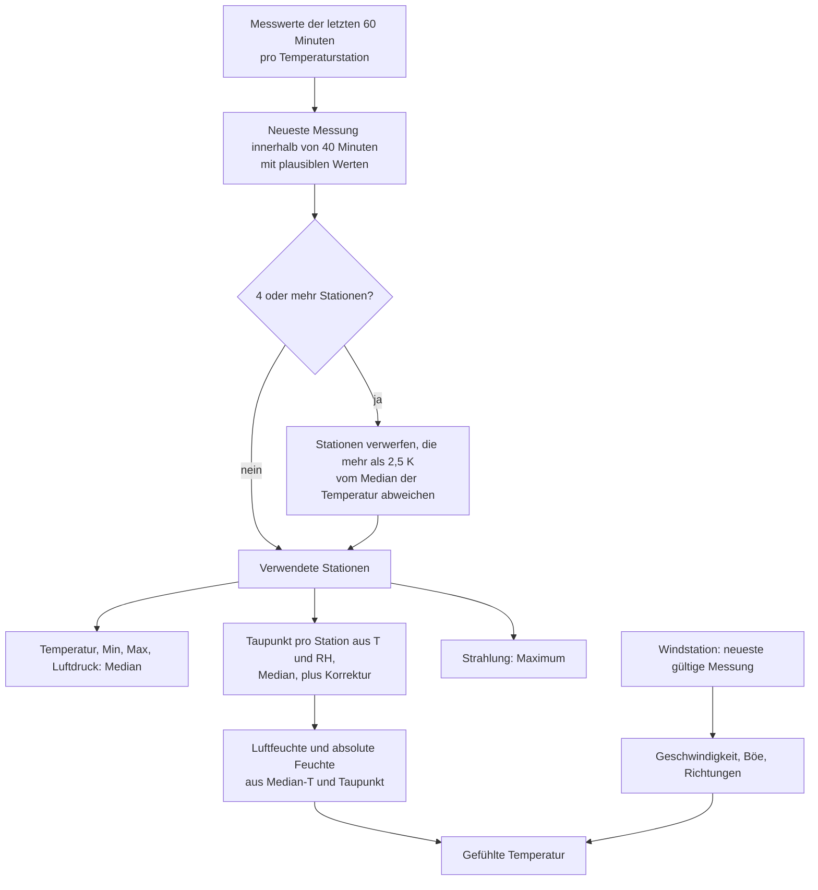

<!-- source: fd2e2df10160afab53716a8364de768481196429 -->
# Aggregation

`aggregation.py` macht aus den letzten Messungen der gewählten Stationen eine `Estimate`.



## Plausibilität

Eine Messung wird verwendet, wenn sie höchstens `MAX_MEASUREMENT_AGE` alt ist. Werte
außerhalb dieser Bereiche werden verworfen; bleibt nichts übrig, wird die nächstältere
Messung versucht.

| Feld | Bereich |
|---|---|
| Temperatur, Minimum, Maximum | −30 bis 45 °C |
| Luftfeuchte | 1 bis 100 % |
| Luftdruck | 850 bis 1100 hPa |
| Strahlung | 0 bis 1500 W/m² |
| Windgeschwindigkeit | 0 bis 60 m/s |
| Böen (3 s, 1 s) | 0 bis 80 m/s |
| Richtungen | 0 bis 360° |

## Ausreißer

Ab `OUTLIER_MIN_STATIONS` Stationen werden Stationen, deren Temperatur um mehr als
`OUTLIER_MAX_DEVIATION_K` vom Median abweicht, bei allen Werten weggelassen. Sie stehen im
Attribut `dropped_outliers`.

## Luftfeuchte

Relative Feuchte über Stationen mit unterschiedlichen Temperaturen zu mitteln, ist
physikalisch falsch, deshalb rechnet die Integration über den Taupunkt:

1. Taupunkt pro Station aus ihrer Temperatur und Luftfeuchte.
2. Median dieser Taupunkte plus Taupunkt-Korrektur, höchstens die Median-Temperatur.
3. Relative Feuchte aus Median-Temperatur und diesem Taupunkt, höchstens 100 %.
4. `humidity_uncorrected` ist dasselbe ohne Korrektur.

Magnus-Formel über Wasser (Sonntag 1990), `a = 17.62`, `b = 243.12 °C`, `E0 = 6.112 hPa`,
`T` in °C, `RH` in %:

```text
γ   = ln(RH / 100) + a·T / (b + T)
Td  = b·γ / (a − γ)                                  Taupunkt
RH  = 100 · exp(a·Td / (b + Td) − a·T / (b + T))     Luftfeuchte aus Taupunkt
e   = RH / 100 · E0 · exp(a·T / (b + T))             Dampfdruck in hPa
AH  = 216.7 · e / (273.15 + T)                       absolute Feuchte in g/m³
```

## Gefühlte Temperatur

Steadman (1994), wie vom Australian Bureau of Meteorology verwendet, mit der
Windgeschwindigkeit `v` der Windstation in m/s:

```text
AT = T + 0.33·e − 0.70·v − 4.00
```

Sie braucht Luftfeuchte und Wind; ohne Windstation gibt es keine gefühlte Temperatur.

## Strahlung und Wind

- Für die Strahlung zählt das Maximum der Stationen, weil Sensoren im Straßenraum oft
  verschattet sind. Die Zahl der Stationen mit Strahlung wird für den Wetterzustand
  mitgeführt.
- Wind wird nie gemittelt: Geschwindigkeit, Richtung und Böe kommen von der einen
  Windstation. Die Böe ist die 3-Sekunden-Böe, oder die 1-Sekunden-Böe, wenn eine Station
  nur diese hat.

## Wetterzustand

`weather.py` vergleicht die Strahlung mit der Strahlung bei wolkenlosem Himmel nach
Haurwitz (1945), mit `z` als Sonnenzenitwinkel am Standort:

```text
clear sky = 1098 · cos z · exp(−0.057 / cos z)      W/m²
index     = irradiance / clear sky
```

| Index | Zustand |
|---|---|
| ≥ `SUNNY_MIN_CLEAR_SKY_INDEX` (0,55) | sonnig |
| ≥ `PARTLY_CLOUDY_MIN_CLEAR_SKY_INDEX` (0,25) | teilweise bewölkt |
| darunter | bewölkt |

Unter `MIN_SUN_ELEVATION_DEG` (10°) und mit weniger als `MIN_IRRADIANCE_STATIONS` (3)
Stationen bleibt der Zustand unbekannt. Die Schwellen wurden an der DWD-Sonnenscheindauer in
Mannheim kalibriert (10 Tage in 2026, 10-Minuten-Werte), mit dem Maximum von 4 Stationen im
Straßenraum.
