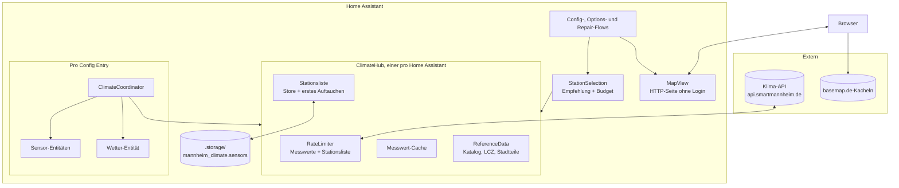
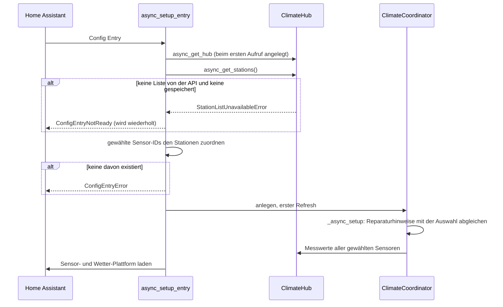

<!-- source: 6d1435fbe02ea90c6320912b226f866736816517 -->
# Architektur

Die Integration liegt in `custom_components/mannheim_climate/`. Die Konventionen für die
Arbeit daran (Befehle, Tests, Commits, Versionierung) stehen in
[`AGENTS.md`](https://github.com/CodeBrauer/ha-mannheim-climate/blob/main/AGENTS.md).

## Komponenten

| Modul | Aufgabe |
|---|---|
| `api.py` | HTTP-Client für `/sensors` und `/measurements/{id}`, Parsen der Antworten, Fehlertypen (`ApiRateLimitError`, `SensorNotFoundError`, …) |
| `hub.py` | Singleton `ClimateHub`: Rate-Limiter, Messwert-Cache, Stationsliste mit gespeicherter Kopie und Zeitpunkt des ersten Auftauchens |
| `stations.py` | Gruppieren der Sensoren zu `Station`s, `recommend()` |
| `reference.py`, `data/` | Mitgelieferter Metadatenkatalog, LCZ-Raster und Stadtteilnamen |
| `selection.py` | `StationSelection`: Empfehlung, Abfrage-Budget und Beschriftungen, gemeinsam für alle Flows und die Karte |
| `config_flow.py` | Config Flow (Standort, Umgebung, Stationen), Reconfigure, Options Flow |
| `map_view.py`, `www/` | Kartenseite als externer Schritt des Config Flows |
| `coordinator.py` | `ClimateCoordinator`: Abfragen, Nachholen, gehaltene Werte, Reparaturhinweise |
| `aggregation.py` | Plausibilität, Ausreißer, Mediane und abgeleitete Werte |
| `sensor.py`, `weather.py` | Entitäten; Schätzung des Wetterzustands |
| `repairs.py` | Fix-Flows für die Reparaturhinweise |
| `diagnostics.py` | Diagnose mit entfernten Koordinaten |
| `geo.py` | Entfernung, Richtung und Clustering ohne Home-Assistant-Imports (auch vom Build-Skript genutzt) |
| `const.py` | Alle Limits, Intervalle und Schwellen, die diese Doku nennt |

## Einrichten eines Standorts

Sensoren werden nur für Werte angelegt, die ein gewählter Sensor misst (`parameters` des
API-Sensors). Änderungen an den Optionen laden den Eintrag neu (`OptionsFlowWithReload`).

## Config Entry

`VERSION = 1`, bisher ohne Migrationen. Änderungen an diesem Format brauchen eine Migration
(siehe [`AGENTS.md`](https://github.com/CodeBrauer/ha-mannheim-climate/blob/main/AGENTS.md#home-assistant-specifics)).

| Teil | Schlüssel | Inhalt |
|---|---|---|
| `unique_id` | | `"{latitude:.3f}_{longitude:.3f}"`, Standorte unter etwa 100 m Abstand sind also Duplikate |
| `data` | `latitude`, `longitude` | Standort |
| | `radius` | Suchradius in Metern (`DEFAULT_SEARCH_RADIUS_M`, höchstens `MAX_SEARCH_RADIUS_M`) |
| | `environment` | `dense`, `open_built`, `industrial` oder `green` (`Environment`) |
| `options` | `temperature_sensors` | API-Sensor-IDs der Temperaturstationen |
| | `wind_sensor` | API-Sensor-ID der Windstation oder `null` |
| | `scan_interval` | Aktualisierungsintervall in Minuten (`SCAN_INTERVAL_CHOICES_MIN`) |
| | `dew_point_offset` | Taupunkt-Korrektur in K |

Entitäten haben die Unique ID `{entry_id}_{key}` (`key` der Entity Description, `weather`
für die Wetter-Entität) und gehören zu einem Dienst-Gerät pro Eintrag. Ab 1.0.0 sind
Entitäts-IDs, Unique IDs und dieses Format stabil.

## Reparaturhinweise

| Issue-ID | Daten | Angelegt von |
|---|---|---|
| `station_offline_{entry_id}_{sensor_id}` | `entry_id`, `sensor_id` | Coordinator, keine gültigen Daten für `STATION_OFFLINE_AFTER` |
| `station_removed_{entry_id}_{sensor_id}` | `entry_id`, `sensor_id` | Coordinator, 404 von der API oder Sensor fehlt in der Stationsliste |
| `new_stations_{entry_id}_{Sensor-IDs mit - verbunden}` | `entry_id` | Coordinator, neue Sensoren in einer Empfehlung, die ins Budget passt |

Alle Hinweise sind behebbar und laufen über `StationRepairFlow`. Die ID eines Vorschlags
enthält seine Sensoren, ein ignorierter Vorschlag bleibt deshalb ignoriert, während ein
anderer neu erscheint. Hinweise zu Sensoren, die nicht mehr gewählt sind, werden beim Setup
gelöscht, alle Hinweise eines Eintrags, wenn er entfernt wird.
