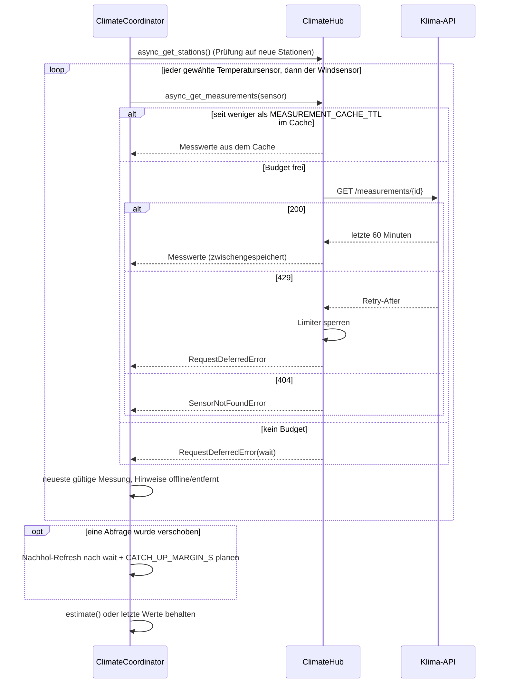
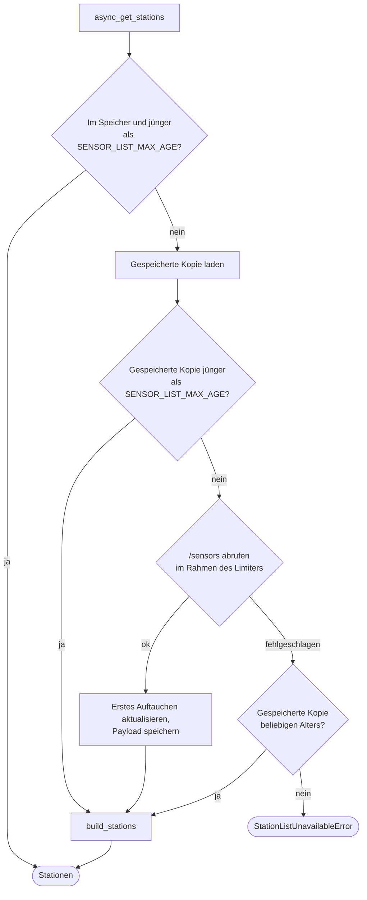
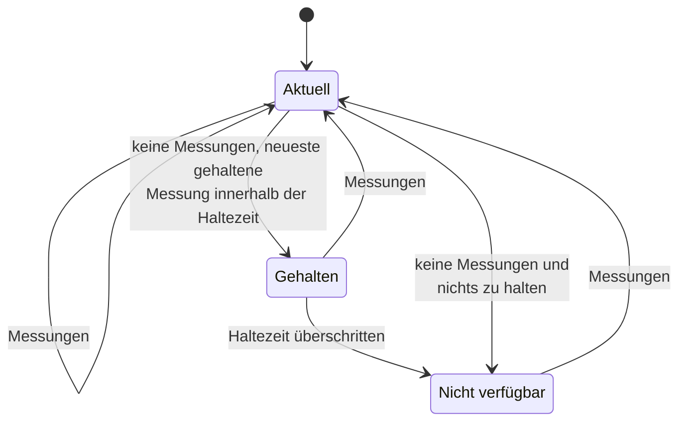

<!-- source: 4010184b037e8117806da2962c48dba0753fd7b1 -->
# Abfragen und API-Zugriff

Jeder API-Zugriff läuft über `ClimateHub` (`hub.py`). Die Limits in `const.py` bilden die
Limits der API pro IP nach; [API-Limits](../user/api-limits.md) erklärt sie für Nutzer.

## Aktualisierungszyklus

Jeder `ClimateCoordinator` läuft alle `scan_interval` Minuten:

- Ein verschobener Sensor nutzt seine Messwerte aus dem Cache, auch wenn sie älter als die
  Cache-Dauer sind; der Nachhol-Refresh fragt ihn ab, sobald das Budget es zulässt. Es ist
  immer nur ein Nachholen gleichzeitig geplant.
- Ein Lock pro Sensor verhindert, dass zwei Standorte denselben Sensor gleichzeitig
  abfragen; der zweite bekommt das Ergebnis aus dem Cache.

## Rate-Limiter

`RateLimiter` merkt sich die Zeitpunkte der letzten Abfragen und prüft gleitende Fenster:

| Limiter | Fenster (`const.py`) |
|---|---|
| Messwerte | 4 pro 120 s, 30 pro 3600 s (`MEASUREMENT_LIMITS`) |
| Stationsliste | 2 pro 900 s, 4 pro 3600 s (`SENSOR_LIST_LIMITS`) |

Eine `429` sperrt den Limiter für `Retry-After` Sekunden (`DEFAULT_RETRY_AFTER_S`, wenn der
Header fehlt). Abgelehnte Abfragen zählen bei der API mit, deshalb versucht es die
Integration nie früher erneut. Die erste `429` einer Serie wird als Warnung protokolliert,
die folgenden auf Debug-Level.

Der Limiter setzt nur die harten Limits durch. Im normalen Betrieb darunter zu bleiben, ist
Aufgabe des geplanten Budgets (`PLANNED_BUDGET_PER_HOUR`), das `StationSelection` bei der
Stationswahl prüft.

## Stationsliste

Die gespeicherte Kopie (`.storage/mannheim_climate.sensors`) enthält den rohen Payload, den
Abrufzeitpunkt und für jeden Sensor, wann er zum ersten Mal auftauchte. Beim ersten Abruf
ohne Historie gelten alle Sensoren als bekannt, neu sind also nur später hinzugekommene. Ein
Sensor gilt `NEW_STATION_PERIOD` lang als neu.

## Gehaltene Werte und Verfügbarkeit

- Eine Messung zählt, wenn sie die neueste einer Station innerhalb von
  `MAX_MEASUREMENT_AGE` mit plausiblen Werten ist.
- Die Haltezeit ist `max(KEEP_VALUES_MIN_AGE, KEEP_VALUES_INTERVALS × scan_interval)`,
  gerechnet ab der neuesten Messung der gehaltenen Schätzung.
- Nicht verfügbar heißt, die Aktualisierung hat `UpdateFailed` ausgelöst:
  `waiting_for_budget` (mit `retry_after`), wenn Abfragen verschoben wurden, sonst
  `no_recent_data`.

## Reparaturhinweise bei der Aktualisierung

Jede Aktualisierung

- prüft, ob die aktuelle Empfehlung neue Sensoren enthält, und legt den Hinweis
  `new_stations` an, ersetzt oder löscht ihn,
- setzt `station_offline`, wenn ein Sensor `STATION_OFFLINE_AFTER` lang keine Messung hatte
  (gezählt ab dem Start des Coordinators), und löscht ihn sonst,
- setzt `station_removed` bei einer 404 und löscht ihn, sobald wieder Messwerte des Sensors
  ankommen, abgerufen oder aus dem Cache.
