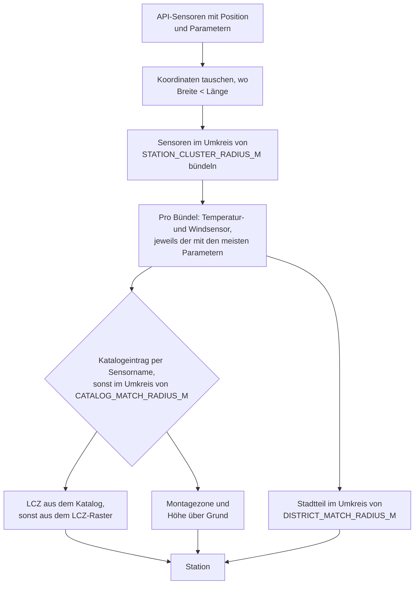

<!-- source: 45a1c661c2490160c51d3e3de36e9d0731ce4128 -->
# Stationen und Referenzdaten

Die API listet Sensoren (Module), keine Stationen, und hat keine Metadaten zum Standort der
Messung. `stations.py` gruppiert die Sensoren und ergänzt Daten, die in
`custom_components/mannheim_climate/data/` mitgeliefert werden.

## Von Sensoren zu Stationen



- Sensoren ohne brauchbare Position werden übersprungen. Manche Sensoren haben vertauschte
  Koordinaten; in Deutschland ist die Breite immer größer als die Länge.
- Mehr Parameter bedeuten eine neuere Hardware-Generation, zum Beispiel mit Luftdruck.
- Der Stationscode sind die ersten 8 Zeichen eines Sensornamens im Katalogformat
  (`0101-046` aus `0101-046-21`), sonst der Name des Temperatursensors.
- Bei der Zuordnung über die Position hat das Temperaturmodul Vorrang vor einem Windmodul am
  selben Ort.
- Eine Station ist erhöht (`is_elevated`), wenn ihre Zone Dach oder Hochpunkt ist oder sie
  über Grund montiert ist. Erhöhte Stationen werden für die Temperatur nicht empfohlen.

## Mitgelieferte Dateien

| Datei | Inhalt | Quelle | Lizenz |
|---|---|---|---|
| `catalog.json` | Metadaten pro Sensormodul: Code, Hardware-ID, Position, Höhen, Zone, LCZ | [Metadatenkatalog Stadtklimamessnetze Mannheim](https://opendata.smartmannheim.de/dataset/metadaten-stadtklimamessnetze-mannheim) | dl-de/by-2-0 |
| `lcz_grid.json` | Raster der lokalen Klimazonen um Mannheim, zlib-komprimiert | Demuzere et al. (2022), [Global map of LCZ](https://doi.org/10.5281/zenodo.6364594) | CC BY 4.0 |
| `districts.json` | Stadtteilname pro Stationsstandort | © OpenStreetMap-Mitwirkende über Nominatim | ODbL 1.0 |

Jede Datei hat einen `source`-Header mit Titel, URL, Lizenz und Erstellungsdatum. Die
Dateien werden einmal im Executor geladen, wenn der Hub angelegt wird.

## Neu erzeugen

Die Dateien erzeugt `scripts/build_reference_data.py`; bearbeite sie nicht von Hand. Neu
erzeugen musst du sie selten, etwa nach einem neuen Metadatenkatalog oder wenn viele neue
Stationen keinen Stadtteil haben:

```bash
uv run --no-project --with openpyxl --with rasterio python scripts/build_reference_data.py
```

Das Skript ruft die Stationsliste einmal ab (oder nutzt mit `--sensors-file` eine
gespeicherte Antwort) und fragt Nominatim einmal pro Stationsstandort, der noch nicht in
`.cache/reference-build/` liegt, mit einer Pause zwischen den Abfragen.
`--only catalog|lcz|districts` erzeugt eine einzelne Datei.
