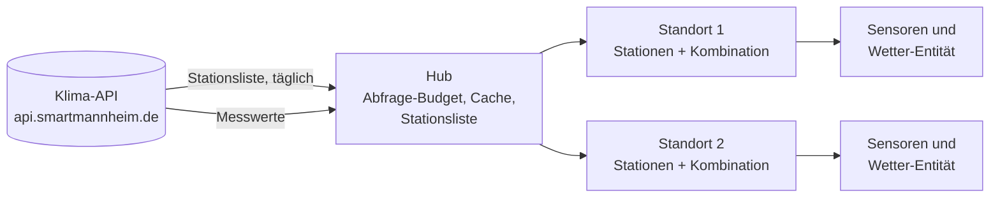

<!-- source: 79a92e4bb5eb6f2b53c6f3194ca0701b382c71cd -->
# Klimamessnetz Mannheim

Home-Assistant-Integration für das dichte Stadtklima-Messnetz von
[Smart City Mannheim](https://smartmannheim.de/) (über 400 Stationen). Sie liefert Klimawerte
für einen Ort deiner Wahl: Temperatur, Luftfeuchte, Taupunkt, absolute Feuchte, gefühlte
Temperatur, Luftdruck, Globalstrahlung und Wind.

Die Integration wählt die Station, die deinen Ort am besten abbildet. Passt die nächste
nicht (zu weit weg, andere Umgebung, auf einem Dach montiert), kombiniert sie stattdessen
mehrere Stationen um dich herum.

!!! note "Inoffizielles Projekt"
    Nicht verbunden mit der Smart City Mannheim GmbH oder der Stadt Mannheim.

## Warum diese Integration

Die Idee entstand aus einem einfachen Wunsch: eine gute Außentemperatur in Home Assistant,
die vor Ort gemessen und nicht über die globale Anbindung eines Wetterdienstes aus
Wettermodellen geschätzt wird. Die üblichen Alternativen überzeugen dafür kaum:

- **Zigbee- und Tuya-Klimasensoren** taugen draußen meist wenig: keine aktive Belüftung,
  der Montagepunkt oder Untergrund heizt sich auf, die Sensoren sind teils ungenau, und
  die Batterien müssen oft gewechselt werden.
- **Eine eigene Wetterstation** ist vergleichsweise teuer und muss zusätzlich
  Smart-Home-fähig sein.

Immer mehr Städte betreiben eigene Stadtklima-Messnetze. Diese Integration macht das Netz
von Smart City Mannheim in Home Assistant nutzbar.

## Funktionen

- **Standort auf der Karte**, vorbelegt mit deinem Zuhause aus Home Assistant.
- **Stationsempfehlung** nach Entfernung, Umgebung (lokale Klimazonen) und Montagehöhe,
  mit einem Klick übernehmen oder selbst wählen.
- **Interaktive Stationskarte**, die nur so viele Stationen zulässt, wie ins API-Budget
  passen, und das resultierende Aktualisierungsintervall live anzeigt.
- **Eine Station oder eine Kombination**: Median mehrerer Stationen ohne Ausreißer.
- **Sensoren und eine Wetter-Entität** mit allen aktuellen Werten, dazu Diagnose-Sensoren.
- **Hält die API-Limits ein** mit gemeinsamem Abfrage-Budget und Cache für alle Standorte.
- **Mehrere Standorte** (Zuhause, Arbeit, …), jeder als eigenes Gerät.
- **Reparaturhinweise**, wenn eine gewählte Station keine Daten mehr liefert oder
  verschwindet, und **Vorschläge**, wenn neue Stationen in der Nähe hinzukommen.
- Deutsch und Englisch.

## So funktioniert es

Alle Standorte teilen sich einen Hub, der mit der API spricht. Eine Station, die zwei
Standorte nutzen, wird deshalb nur einmal abgefragt, und die Abfragen aller Standorte
zusammen bleiben im API-Limit. Jeder Standort fragt seine Stationen ab und kombiniert ihre
letzten Werte zu einem Satz Entitäten.

## Wie geht es weiter

| Ich möchte | Seite |
|---|---|
| Die Integration installieren | [Installation](user/installation.md) |
| Einen Standort hinzufügen und Stationen wählen | [Einrichtung](user/setup.md) |
| Wissen, was jede Entität bedeutet | [Entitäten](user/entities.md) |
| Verstehen, welche Stationen empfohlen werden | [Stationsempfehlung](user/stations.md) |
| Wissen, wie viele Stationen passen und warum | [API-Limits](user/api-limits.md) |
| Fehlende Werte oder einen Reparaturhinweis beheben | [Reparaturen und Fehlersuche](user/troubleshooting.md) |
| Am Code arbeiten | [Architektur](developer/architecture.md) |
