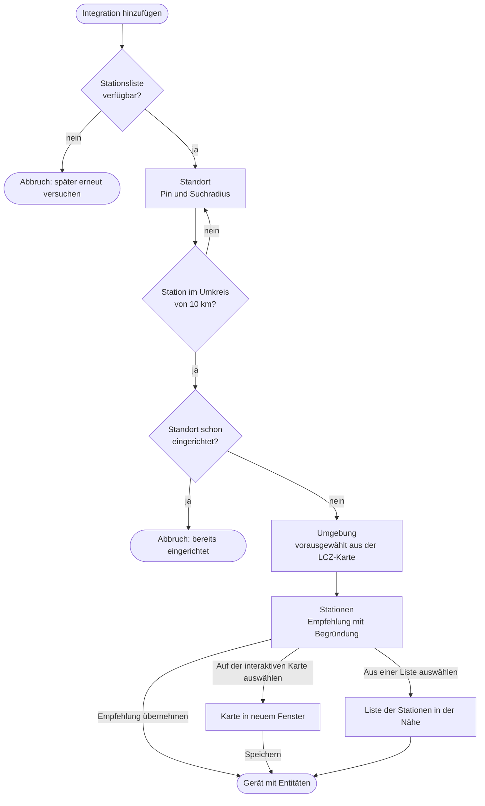

<!-- source: 34407d5ff5e2ce407c36cde1c79a7d66655b7b4d -->
# Einrichtung

*Einstellungen → Geräte & Dienste → Integration hinzufügen → Klimamessnetz Mannheim*

Jeder Standort, den du hinzufügst, wird ein eigenes Gerät mit eigenen Entitäten.

## 1. Standort

Verschiebe den Pin an den Ort, für den du Werte möchtest. Er startet bei deinem Zuhause aus
Home Assistant. Der Kreis ist der Suchradius für die Empfehlung: standardmäßig 3 km,
höchstens 10 km.

- Im Umkreis von 10 km muss es eine Temperaturstation geben, sonst zeigt der Schritt einen
  Fehler.
- Zwei Standorte, die weniger als etwa 100 m auseinander liegen, gelten als derselbe und
  lassen sich nicht doppelt anlegen.

## 2. Umgebung

Wie ist die Gegend um den Standort bebaut? Danach richtet sich, welche Stationen ihn am
besten abbilden (siehe [Stationsempfehlung](stations.md)).

| Option | Lokale Klimazonen |
|---|---|
| Dicht bebaut (geschlossene Innenstadt-Blöcke) | 1–3 |
| Locker bebaut (Einzel-, Reihenhäuser, Blöcke mit Grün) | 4–6, 9 |
| Industrie oder große Gewerbebauten | 7, 8, 10 |
| Grün oder offen (Park, Wald, Felder, Wasser) | 11–17 |

Vorausgewählt ist die Option laut Karte der lokalen Klimazonen am Standort. Ändere sie, wenn
deine direkte Umgebung anders ist, zum Beispiel bei einem Haus neben einem großen Park.

## 3. Stationen

Der Schritt zeigt die Empfehlung, warum sie gewählt wurde, und das resultierende
Aktualisierungsintervall.

| Auswahl | Was passiert |
|---|---|
| **Empfehlung übernehmen** | Übernimmt die empfohlenen Stationen und die Windstation. Nur angeboten, wenn die Empfehlung ins [API-Budget](api-limits.md) passt. |
| **Auf der interaktiven Karte auswählen** | Öffnet die Karte in einem neuen Fenster. Klicke Stationen an, um sie aus- oder abzuwählen, und wähle eine Windstation. Nach *Speichern* geht die Einrichtung von selbst weiter. |
| **Aus einer Liste auswählen** | Zeigt die 15 nächsten Stationen, die Empfehlung vorausgewählt, und eine Liste der Windstationen. |

Beschriftungen wie `444 m ↙ · Seckenheim (2507LH096) · locker bebaut · empfohlen` zeigen
Entfernung und Richtung von deinem Standort aus, den Stadtteil, den Stationscode, die
Umgebung und Kennzeichen (*Dach/Hochpunkt*, *empfohlen*).

### Interaktive Karte

- Zeigt bis zu 60 Stationen um den Standort, nach Entfernung nummeriert, mit dem Suchradius.
- Lässt nur so viele Stationen zu, wie ins API-Budget passen, und zeigt das
  Aktualisierungsintervall live an.
- Der Link gilt nur für diese Einrichtung und 30 Minuten lang. Ist er abgelaufen, starte die
  Einrichtung neu.
- Die Kartenkacheln kommen von [basemap.de](https://basemap.de/) und werden von deinem
  Browser geladen.

## Das Gerät

Das Gerät heißt wie der Standort in Home Assistant, wenn der Pin höchstens 100 m von deinem
Zuhause entfernt ist, sonst wie der Stadtteil. Die Entitäts-IDs folgen dem Gerätenamen, zum
Beispiel `sensor.seckenheim_temperatur`. Beides kannst du wie gewohnt umbenennen.

Das Aktualisierungsintervall wird automatisch gewählt: das kürzeste von 15, 20 und 30
Minuten, das ins API-Budget passt. Neue Werte kommen ohnehin nur alle 10 Minuten, mit 10–20
Minuten Verzögerung.

## Stationen und Einstellungen ändern

*Konfigurieren* am Integrationseintrag:

| Option | Bedeutung |
|---|---|
| Stationen für Temperatur und Luftfeuchte | Bis zu 6 Stationen; das angezeigte Maximum ergibt sich aus dem API-Budget beim gewählten Intervall. |
| Station für Wind | Eine Station oder keine. Wind wird nicht gemittelt. |
| Aktualisierungsintervall | 10, 15, 20 oder 30 Minuten, soweit das API-Budget es zulässt. |
| Taupunkt-Korrektur | −3,0 bis +3,0 K, wird vor der Berechnung der Luftfeuchte auf den Taupunkt addiert. Das Netz misst eher zu feucht; im 31-Tage-Vergleich mit der DWD-Station Mannheim passten −1,3 K. |

Speichern lädt den Standort neu. Misst die neue Auswahl weniger Werte, werden Entitäten, die
nicht mehr bereitgestellt werden, nicht verfügbar und lassen sich löschen.

## Standort verschieben

*Neu konfigurieren* am Integrationseintrag fragt nach dem neuen Standort und danach erneut
nach Umgebung und Stationen. Das ist auch der Weg zur interaktiven Karte für einen
bestehenden Standort, weil Home Assistant externe Fenster in Options-Dialogen nicht
zuverlässig anzeigt. Deine übrigen Optionen, etwa die Taupunkt-Korrektur, bleiben erhalten.

## Mehrere Standorte

Füge die Integration für jeden Ort erneut hinzu (Zuhause, Arbeit, Garten, …). Alle Standorte
teilen sich das API-Budget, jeder weitere Standort lässt den anderen also weniger Stationen
oder ein längeres Intervall.
