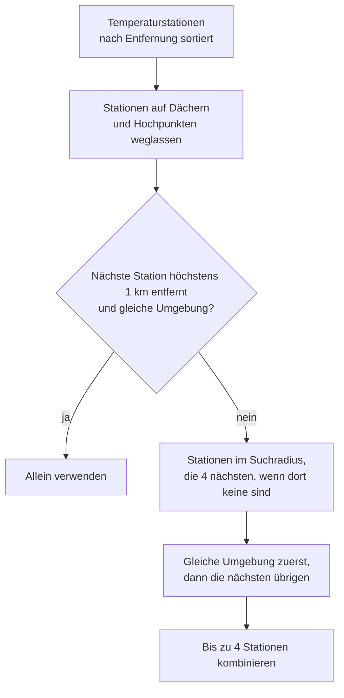

<!-- source: ed8f86afc31a7033dfbd34be2d795ff92f46c432 -->
# Stationsempfehlung

Das Netz hat über 400 Stationen, viele davon in Straßenschluchten, auf Dächern oder in Parks,
oft nur wenige hundert Meter voneinander entfernt. Ihre Werte unterscheiden sich, deshalb
ist die nächste Station nicht immer die beste für deinen Ort.

## Stationen

Eine Station ist ein Ort mit einem oder mehreren Sensormodulen: Temperatur und Luftfeuchte,
oft Luftdruck und Strahlung, an manchen Masten auch Wind. Module, die höchstens 15 m
auseinander liegen, gelten als eine Station. Jede Station hat:

| Eigenschaft | Quelle |
|---|---|
| Code, z. B. `0101-046` | Sensornamen der API |
| Stadtteil | OpenStreetMap |
| Umgebung | Lokale Klimazone aus dem Metadatenkatalog der Stadt, sonst aus der globalen LCZ-Karte |
| Dach oder Hochpunkt | Montagezone und Höhe über Grund aus dem Metadatenkatalog |

Details: [Stationen und Referenzdaten](../developer/reference-data.md).

## So entsteht die Empfehlung

- Stationen auf Dächern oder Hochpunkten messen andere Temperaturen als im Straßenraum und
  werden für die Temperatur nicht empfohlen. Du kannst sie trotzdem selbst wählen; sie sind
  mit *Dach/Hochpunkt* gekennzeichnet.
- Die Windstation ist die nächste Station mit Windsensor, egal wo sie montiert ist.
- Die Begründung steht bei der Empfehlung: Die nächste Station passt, ist zu weit weg oder
  hat eine andere Umgebung.
- *Empfehlung übernehmen* wird nur angeboten, wenn sie ins [API-Budget](api-limits.md)
  passt, zum Beispiel nicht, wenn andere Standorte schon den Großteil davon nutzen.

## Selbst wählen

- **Eine Station** liefert genau ihre Werte, einschließlich kurzer lokaler Effekte.
- **Mehrere Stationen** liefern ihren Median, der ruhiger ist und näher am typischen Wert
  der Gegend liegt. Ab 4 Stationen werden Ausreißer verworfen.
- Höchstens 6 Stationen pro Standort; wie viele passen, hängt vom API-Budget ab.

## Neue Stationen

Die Stadt ergänzt immer wieder Stationen. Enthält die tägliche Stationsliste Stationen, die
in den letzten 30 Tagen neu hinzugekommen sind und zur aktuellen Empfehlung für einen
Standort gehören, schlägt ein Reparaturhinweis die neue Empfehlung vor.

- Die Auswahl ändert sich nur, wenn du den Vorschlag übernimmst, weil andere Stationen die
  Werte (Sprünge in Langzeitstatistiken) und das API-Budget verändern.
- Behältst du deine Stationen, wird der Vorschlag ignoriert. Er kommt erst bei einem anderen
  Vorschlag wieder.
- Passt die Empfehlung nicht ins API-Budget, erscheint kein Vorschlag.

Siehe [Reparaturen und Fehlersuche](troubleshooting.md#neue-stationen-in-der-nahe).
