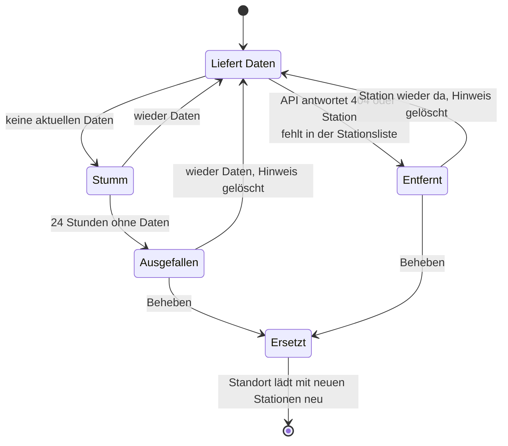
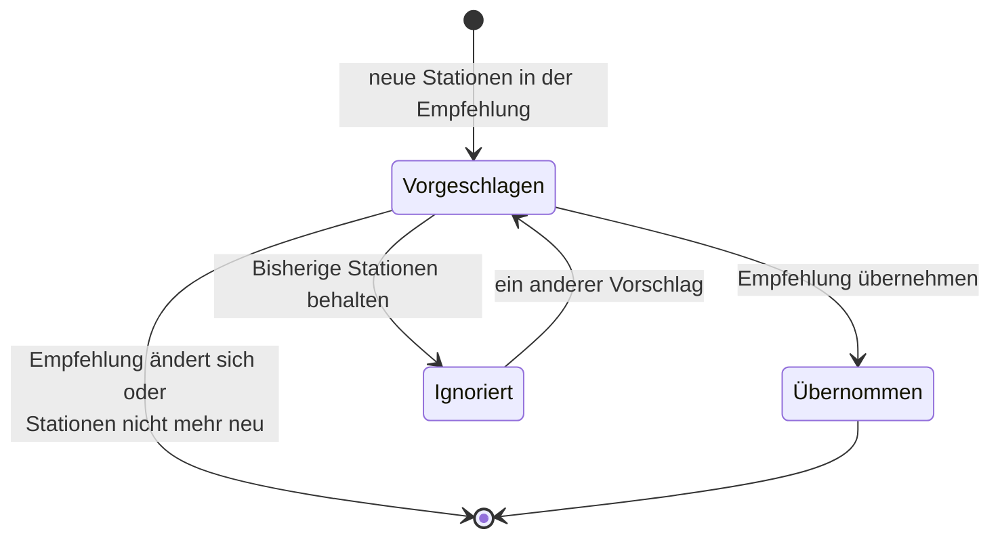

<!-- source: 5a9c42eaeacded6128ea2bf9acd6051c8d6ac3c8 -->
# Reparaturen und Fehlersuche

## Reparaturhinweise

Probleme, die du beheben kannst, erscheinen unter *Einstellungen → System → Reparaturen*.
Jeder Hinweis hat einen Button *Beheben*, der durch die Lösung führt.

| Hinweis | Wann | Lösung |
|---|---|---|
| Station *X* sendet keine Daten | Eine gewählte Station hat 24 Stunden lang keine aktuellen Daten geliefert | Empfehlung ohne diese Station übernehmen oder aus einer Liste auswählen |
| Station *X* gibt es nicht mehr | Die API kennt eine gewählte Station nicht mehr | Empfehlung ohne diese Station übernehmen oder aus einer Liste auswählen |
| Neue Stationen bei *Standort* | Neue Stationen gehören zur Empfehlung, 30 Tage lang nach ihrem Erscheinen | Empfehlung übernehmen oder bisherige Stationen behalten |

Solange eine Station fehlt, werden die übrigen gewählten Stationen weiter verwendet. Der
Hinweis zu einer ausgefallenen Station verschwindet von selbst, wenn sie wieder Daten
liefert oder du sie nicht mehr verwendest. *Empfehlung übernehmen* wird nur angeboten, wenn
sie ins [API-Budget](api-limits.md) passt.



### Neue Stationen in der Nähe



Behältst du deine Stationen, wandert der Hinweis zu den ignorierten Reparaturen, wo du ihn
weiterhin findest. Derselbe Vorschlag wird nicht noch einmal angezeigt.

## API-Ausfall oder Rate-Limit

Dafür gibt es keinen Reparaturhinweis, weil du nichts beheben kannst:

1. Stationen, deren Abfragen übersprungen wurden, werden kurz danach erneut abgefragt.
2. Ohne aktuelle Daten behalten die Entitäten ihre letzten Werte, bis die letzte Messung
   60 Minuten alt ist, oder drei Aktualisierungsintervalle, wenn das länger ist.
3. Danach sind die Entitäten nicht verfügbar, bis wieder Daten kommen.

Ein Rate-Limit wird einmal als Warnung protokolliert. Passiert das oft, nutzen
wahrscheinlich andere Geräte oder Skripte an deinem Internetanschluss die API ebenfalls;
wähle weniger Stationen oder ein längeres Intervall.

Automationen können auf einen Ausfall reagieren, zum Beispiel mit einer Push-Nachricht aufs
Handy. Passe Entität und Benachrichtigungsdienst an deine Installation an:

```yaml
alias: "Klimamessnetz: keine Temperatur"
triggers:
  - trigger: state
    entity_id: sensor.seckenheim_temperatur
    to: unavailable
    for:
      minutes: 30
actions:
  - action: notify.mobile_app_mein_handy
    data:
      message: Seit 30 Minuten keine Temperatur vom Klimamessnetz Mannheim.
```

## Meldungen

| Meldung | Bedeutung |
|---|---|
| Im Umkreis von 10 km gibt es keine Station. | Wähle einen Ort in oder bei Mannheim. |
| Die Stationsliste konnte nicht von api.smartmannheim.de geladen werden. | Die API ist nicht erreichbar und es gibt noch keine gespeicherte Stationsliste. Beim Start wiederholt Home Assistant die Einrichtung von selbst. |
| Zu viele API-Abfragen pro Stunde. | Die Auswahl passt nicht ins Budget. Wähle weniger Stationen, keine Windstation oder ein längeres Intervall. |
| Keine der gewählten Stationen existiert mehr. | Alle Stationen des Standorts sind weg. Wähle unter *Konfigurieren* neue. |
| Das Abfrage-Budget der API ist gerade aufgebraucht. | Der Standort versucht es nach der angegebenen Zeit von selbst erneut. |
| Keine der gewählten Stationen hat in den letzten 40 Minuten Daten geliefert. | Die Entitäten sind nicht verfügbar, bis wieder Daten kommen. |

## Diagnose und Logs

- *Diagnose herunterladen* am Integrationseintrag enthält die gewählten Stationen, die
  letzten Messungen, die kombinierten Werte und den Zustand des Abfrage-Budgets. Die
  Koordinaten des Standorts werden entfernt.
- Für Details aktivierst du am Integrationseintrag die *Debug-Protokollierung*, oder dauerhaft
  in der `configuration.yaml`:

```yaml
logger:
  logs:
    custom_components.mannheim_climate: debug
```

Wenn du [ein Problem meldest](https://github.com/CodeBrauer/ha-mannheim-climate/issues),
häng die Diagnose und das Debug-Log an.
