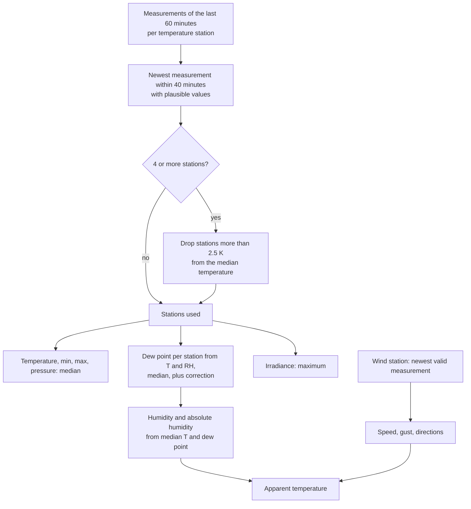

# Aggregation

`aggregation.py` turns the latest readings of the selected stations into one `Estimate`.



## Plausibility

A measurement is used if it is at most `MAX_MEASUREMENT_AGE` old. Values outside these
ranges are dropped; if nothing is left, the next older measurement is tried.

| Field | Range |
|---|---|
| Temperature, minimum, maximum | −30 to 45 °C |
| Humidity | 1 to 100 % |
| Pressure | 850 to 1100 hPa |
| Irradiance | 0 to 1500 W/m² |
| Wind speed | 0 to 60 m/s |
| Gusts (3 s, 1 s) | 0 to 80 m/s |
| Directions | 0 to 360° |

## Outliers

With at least `OUTLIER_MIN_STATIONS` stations, stations whose temperature differs from the
median by more than `OUTLIER_MAX_DEVIATION_K` are left out of all values. They are listed in
the `dropped_outliers` attribute.

## Humidity

Averaging relative humidity across stations with different temperatures is physically
wrong, so the integration works with the dew point:

1. Dew point per station from its temperature and humidity.
2. Median of these dew points, plus the dew point correction, at most the median temperature.
3. Relative humidity from the median temperature and that dew point, at most 100 %.
4. `humidity_uncorrected` is the same without the correction.

Magnus formula over water (Sonntag 1990), `a = 17.62`, `b = 243.12 °C`, `E0 = 6.112 hPa`,
`T` in °C, `RH` in %:

```text
γ   = ln(RH / 100) + a·T / (b + T)
Td  = b·γ / (a − γ)                                  dew point
RH  = 100 · exp(a·Td / (b + Td) − a·T / (b + T))     humidity from dew point
e   = RH / 100 · E0 · exp(a·T / (b + T))             vapour pressure in hPa
AH  = 216.7 · e / (273.15 + T)                       absolute humidity in g/m³
```

## Apparent temperature

Steadman (1994), as used by the Australian Bureau of Meteorology, with the wind speed `v`
in m/s of the wind station:

```text
AT = T + 0.33·e − 0.70·v − 4.00
```

It needs humidity and wind; without a wind station there is no apparent temperature.

## Irradiance and wind

- Irradiance uses the maximum of the stations, because street-level sensors are often
  shaded. The number of stations with irradiance is kept for the weather condition.
- Wind is never averaged: speed, direction and gust come from the one wind station. The gust
  is the 3-second gust, or the 1-second gust if a station only has that.

## Weather condition

`weather.py` compares the irradiance with the clear-sky irradiance after Haurwitz (1945),
with `z` the solar zenith angle at the location:

```text
clear sky = 1098 · cos z · exp(−0.057 / cos z)      W/m²
index     = irradiance / clear sky
```

| Index | Condition |
|---|---|
| ≥ `SUNNY_MIN_CLEAR_SKY_INDEX` (0.55) | sunny |
| ≥ `PARTLY_CLOUDY_MIN_CLEAR_SKY_INDEX` (0.25) | partly cloudy |
| below | cloudy |

The condition stays unknown below `MIN_SUN_ELEVATION_DEG` (10°) and with fewer than
`MIN_IRRADIANCE_STATIONS` (3) stations. The thresholds were calibrated against the DWD
sunshine duration in Mannheim (10 days in 2026, 10-minute values) using the maximum of 4
street-level stations.
