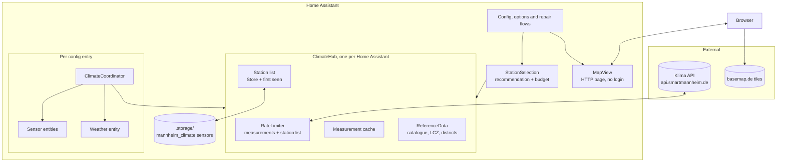
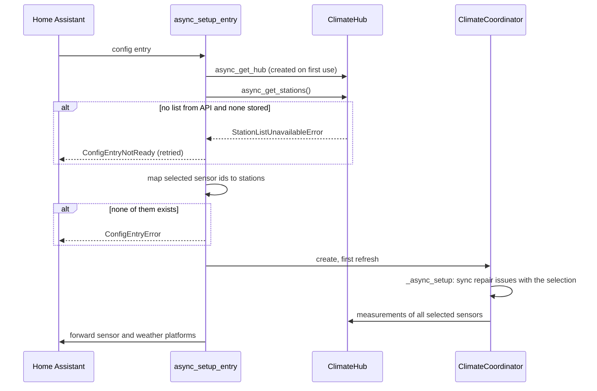
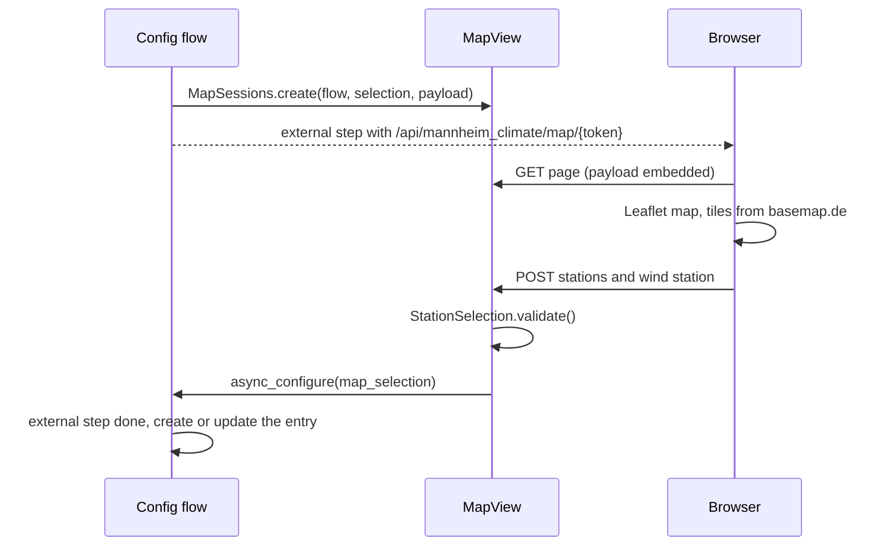

# Architecture

The integration lives in `custom_components/mannheim_climate/`. Conventions for working on
it (commands, tests, commits, versioning) are in
[`AGENTS.md`](https://github.com/CodeBrauer/ha-mannheim-climate/blob/main/AGENTS.md).

## Components

| Module | Responsibility |
|---|---|
| `api.py` | HTTP client for `/sensors` and `/measurements/{id}`, response parsing, error types (`ApiRateLimitError`, `SensorNotFoundError`, ...) |
| `hub.py` | `ClimateHub` singleton: rate limiters, measurement cache, station list with stored copy and first-seen times |
| `stations.py` | Grouping sensors into `Station`s, `recommend()` |
| `reference.py`, `data/` | Bundled metadata catalogue, LCZ grid and district names |
| `selection.py` | `StationSelection`: recommendation, request budget and labels, shared by all flows and the map |
| `config_flow.py` | Config flow (location, surroundings, stations), reconfigure, options flow |
| `map_view.py`, `www/` | Map page served as external step of the config flow |
| `coordinator.py` | `ClimateCoordinator`: polling, catch-up, kept values, repair issues |
| `aggregation.py` | Plausibility, outliers, medians and derived values |
| `sensor.py`, `weather.py` | Entities; the weather condition estimate |
| `repairs.py` | Fix flows for the repair issues |
| `diagnostics.py` | Diagnostics with redacted coordinates |
| `geo.py` | Distance, bearing and clustering without Home Assistant imports (also used by the build script) |
| `const.py` | All limits, intervals and thresholds named in this documentation |

## Setting up a location

Sensors are created only for values a selected sensor measures (`parameters` of the API
sensor). Option changes reload the entry (`OptionsFlowWithReload`).

## Station map page

The map is an external step of the config flow, served by Home Assistant itself:

- The page needs no Home Assistant login, so the link is an unguessable token that is bound
  to the flow and expires after `MAP_SESSION_TTL`. Responses are not cached.
- The server validates the selection again; the page only helps to stay within the budget.
- `www/map.js` repeats the budget rules of `StationSelection` to show the interval live.
  Change both together.
- Texts come from the `map_page` selector in `strings.json`, in the system language.
- Leaflet is vendored in `www/leaflet/`; static files are served under `STATIC_URL` with a
  content hash as cache buster.

## Config entry

`VERSION = 1`, no migrations yet. Changes to this format need a migration (see
[`AGENTS.md`](https://github.com/CodeBrauer/ha-mannheim-climate/blob/main/AGENTS.md#home-assistant-specifics)).

| Part | Key | Content |
|---|---|---|
| `unique_id` | | `"{latitude:.3f}_{longitude:.3f}"`, so locations closer than about 100 m are duplicates |
| `data` | `latitude`, `longitude` | Location |
| | `radius` | Search radius in metres (`DEFAULT_SEARCH_RADIUS_M`, at most `MAX_SEARCH_RADIUS_M`) |
| | `environment` | `dense`, `open_built`, `industrial` or `green` (`Environment`) |
| `options` | `temperature_sensors` | API sensor ids of the temperature stations |
| | `wind_sensor` | API sensor id of the wind station or `null` |
| | `scan_interval` | Update interval in minutes (`SCAN_INTERVAL_CHOICES_MIN`) |
| | `dew_point_offset` | Dew point correction in K |

Entities have the unique id `{entry_id}_{key}` (`key` of the entity description, `weather`
for the weather entity) and belong to one service device per entry. From 1.0.0 on, entity
ids, unique ids and this format are stable.

## Repair issues

| Issue id | Data | Created by |
|---|---|---|
| `station_offline_{entry_id}_{sensor_id}` | `entry_id`, `sensor_id` | Coordinator, no valid data for `STATION_OFFLINE_AFTER` |
| `station_removed_{entry_id}_{sensor_id}` | `entry_id`, `sensor_id` | Coordinator, 404 from the API or sensor missing from the station list |
| `new_stations_{entry_id}_{sensor ids joined by -}` | `entry_id` | Coordinator, new sensors in a recommendation that fits the budget |

All issues are fixable and handled by `StationRepairFlow`. The id of a suggestion contains
its sensors, so an ignored suggestion stays ignored while a different one is raised anew.
Issues of sensors that are no longer selected are deleted on setup, all issues of an entry
when it is removed.
