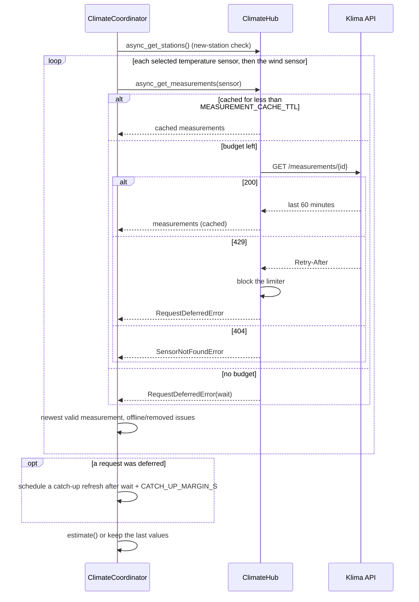
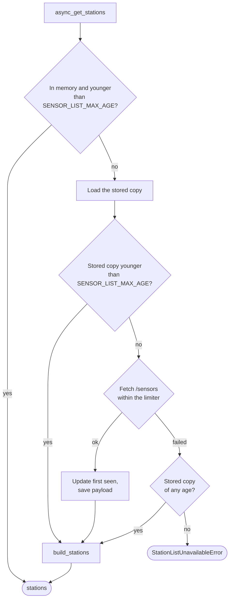
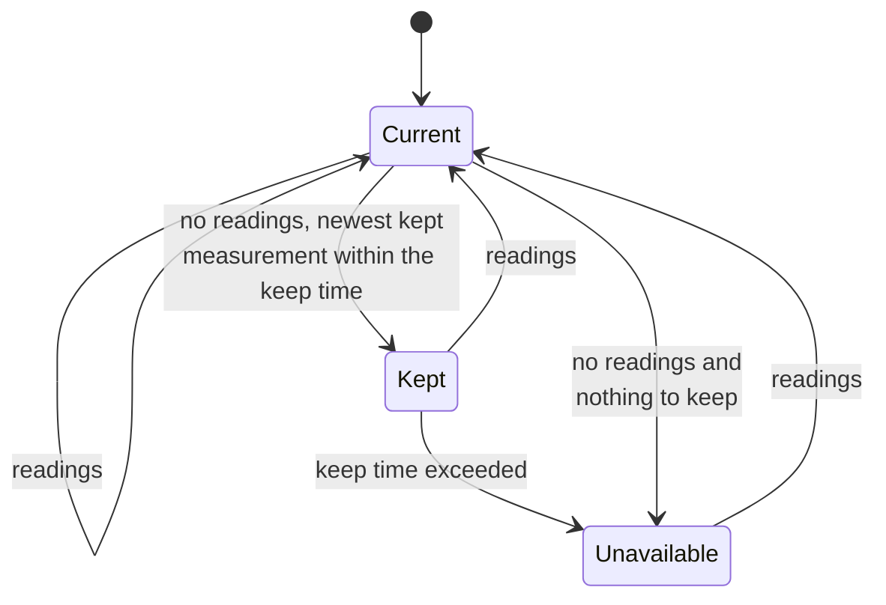

# Polling and API access

All API access goes through `ClimateHub` (`hub.py`). The limits in `const.py` mirror the
API's per-IP limits; [API limits](../user/api-limits.md) explains them for users.

## Update cycle

Each `ClimateCoordinator` runs every `scan_interval` minutes:

- A deferred sensor uses its cached measurements, even if they are older than the cache
  lifetime; the catch-up refresh fetches it once the budget allows it. Only one catch-up is
  pending at a time.
- A lock per sensor prevents two locations from fetching the same sensor at once; the
  second one gets the cached result.

## Rate limiter

`RateLimiter` keeps the timestamps of recent requests and checks sliding windows:

| Limiter | Windows (`const.py`) |
|---|---|
| Measurements | 4 per 120 s, 30 per 3600 s (`MEASUREMENT_LIMITS`) |
| Station list | 2 per 900 s, 4 per 3600 s (`SENSOR_LIST_LIMITS`) |

A `429` blocks the limiter for `Retry-After` seconds (`DEFAULT_RETRY_AFTER_S` if the header
is missing). Rejected requests count at the API too, so the integration never retries
early. The first `429` of a streak is logged as a warning, the following ones at debug
level.

The limiter only enforces the hard limits. Staying below them in normal operation is the job
of the planned budget (`PLANNED_BUDGET_PER_HOUR`), which `StationSelection` checks when
stations are chosen.

## Station list

The stored copy (`.storage/mannheim_climate.sensors`) holds the raw payload, the fetch time
and the time each sensor first appeared. On the first fetch without history all sensors
count as known, so only sensors added later are new. A sensor is new for
`NEW_STATION_PERIOD`.

## Kept values and availability

- A reading is the newest measurement of a station within `MAX_MEASUREMENT_AGE` that has
  plausible values.
- The keep time is `max(KEEP_VALUES_MIN_AGE, KEEP_VALUES_INTERVALS × scan_interval)`,
  measured from the newest measurement of the kept estimate.
- Unavailable means the update raised `UpdateFailed`: `waiting_for_budget` (with
  `retry_after`) if requests were deferred, otherwise `no_recent_data`.

## Repair issues during updates

Every update:

- checks whether the current recommendation contains new sensors and creates, replaces or
  deletes the `new_stations` issue,
- sets `station_offline` when a sensor had no reading for `STATION_OFFLINE_AFTER` (counted
  from the coordinator start), and deletes it otherwise,
- sets `station_removed` on a 404 and deletes it as soon as measurements of the sensor
  arrive again, fetched or from the cache.
