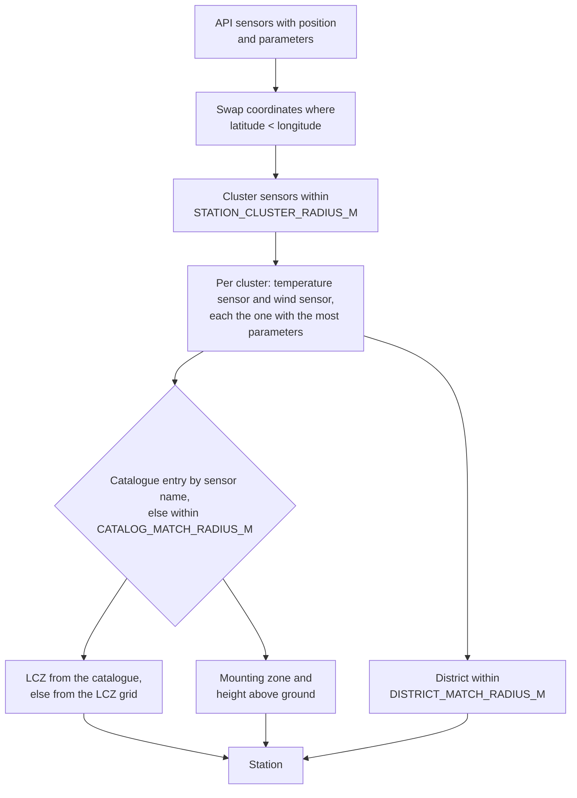

# Stations and reference data

The API lists sensors (modules), not stations, and has no siting metadata. `stations.py`
groups the sensors and attaches data bundled in `custom_components/mannheim_climate/data/`.

## From sensors to stations



- Sensors without a usable position are skipped. Some sensors have swapped coordinates; in
  Germany the latitude is always larger than the longitude.
- More parameters means a newer hardware generation, for example with pressure.
- The station code is the first 8 characters of a catalogue-style sensor name
  (`0101-046` from `0101-046-21`), otherwise the name of the temperature sensor.
- A position match prefers the temperature module over a co-located wind module.
- A station is elevated (`is_elevated`) if its zone is roof or high point or it is mounted
  above ground. Elevated stations are not recommended for temperature.

## Bundled files

| File | Content | Source | Licence |
|---|---|---|---|
| `catalog.json` | Siting metadata per sensor module: code, hardware id, position, heights, zone, LCZ | [Metadatenkatalog Stadtklimamessnetze Mannheim](https://opendata.smartmannheim.de/dataset/metadaten-stadtklimamessnetze-mannheim) | dl-de/by-2-0 |
| `lcz_grid.json` | Local Climate Zone raster around Mannheim, zlib-compressed | Demuzere et al. (2022), [Global map of LCZ](https://doi.org/10.5281/zenodo.6364594) | CC BY 4.0 |
| `districts.json` | District name per station location | © OpenStreetMap contributors via Nominatim | ODbL 1.0 |

Each file has a `source` header with title, URL, licence and generation date. The files are
loaded once, in the executor, when the hub is created.

## Regenerating

The files are generated by `scripts/build_reference_data.py`; do not edit them by hand.
Regenerate them rarely, for example after a new metadata catalogue or when many new stations
have no district:

```bash
uv run --no-project --with openpyxl --with rasterio python scripts/build_reference_data.py
```

The script fetches the station list once (or reuses a saved response with `--sensors-file`)
and asks Nominatim once per station location that is not cached in `.cache/reference-build/`
yet, with a pause between requests. `--only catalog|lcz|districts` builds a single file.
