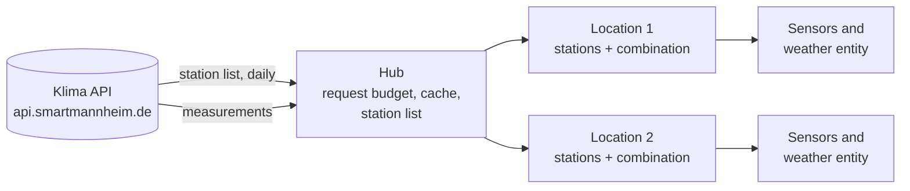

# Klimamessnetz Mannheim

Home Assistant integration for the dense urban climate network of
[Smart City Mannheim](https://smartmannheim.de/) (400+ stations). It provides climate values
for a location of your choice: temperature, humidity, dew point, absolute humidity, apparent
temperature, air pressure, global irradiance and wind.

The integration picks the station that represents your place best. If the nearest one does
not fit (too far away, different surroundings, mounted on a roof), it combines several
stations around you instead.

!!! note "Unofficial project"
    Not affiliated with Smart City Mannheim GmbH or the city of Mannheim.

## Features

- **Location on a map**, pre-filled with your Home Assistant home location.
- **Station recommendation** based on distance, surroundings (Local Climate Zones) and
  mounting height; accept it with one click or choose yourself.
- **Interactive station map** that only allows as many stations as fit the API budget and
  shows the resulting update interval live.
- **One station or a combination**: the median of several stations, outliers removed.
- **Sensors and a weather entity** with all current values, plus diagnostic sensors.
- **Respects the API limits** with a shared request budget and cache for all locations.
- **Several locations** (home, work, ...), each as its own device.
- **Repairs** when a selected station stops delivering data or disappears, and
  **suggestions** when new stations are added nearby.
- English and German.

## How it works

All locations share one hub that talks to the API, so a station used by two locations is
fetched once and the requests of all locations together stay within the API limit. Each
location polls its stations and combines their latest values into one set of entities.

## Where to go next

| I want to | Page |
|---|---|
| Install the integration | [Installation](user/installation.md) |
| Add a location and choose stations | [Setup](user/setup.md) |
| Know what each entity means | [Entities](user/entities.md) |
| Understand which stations are recommended | [Station recommendation](user/stations.md) |
| Know how many stations fit and why | [API limits](user/api-limits.md) |
| Fix missing values or a repair issue | [Repairs and troubleshooting](user/troubleshooting.md) |
| Work on the code | [Architecture](developer/architecture.md) |
