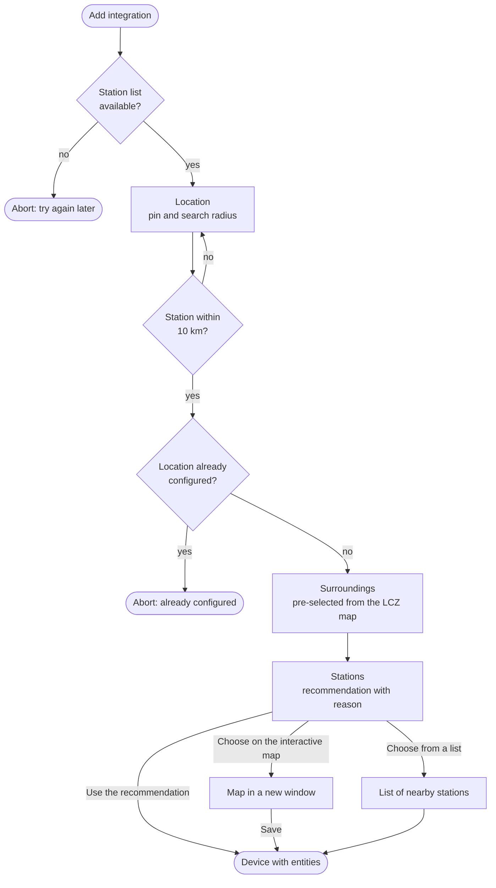

# Setup

*Settings → Devices & services → Add integration → Klimamessnetz Mannheim*

Each location you add becomes its own device with its own entities. The screenshots show the
German user interface.

## 1. Location

Move the pin to the place you want values for. It starts at your Home Assistant home
location. The circle is the search radius for the recommendation: 3 km by default, at most
10 km.

- There must be a temperature station within 10 km, otherwise the step shows an error.
- Two locations closer than about 100 m count as the same and cannot be added twice.

## 2. Surroundings

How is the area around the location built up? The answer decides which stations represent
it best (see [Station recommendation](stations.md)).

| Option | Local Climate Zones |
|---|---|
| Densely built (compact city blocks) | 1–3 |
| Open built-up area (detached or row houses, blocks with green space) | 4–6, 9 |
| Industrial or large commercial buildings | 7, 8, 10 |
| Green or open land (park, forest, fields, water) | 11–17 |

The option is pre-selected from the Local Climate Zone map at the location. Change it if
your direct surroundings differ, for example a house next to a large park.

## 3. Stations

The step shows the recommendation, why it was chosen and the resulting update interval.

| Choice | What happens |
|---|---|
| **Use the recommendation** | Takes the recommended stations and wind station. Only offered if the recommendation fits the [API budget](api-limits.md). |
| **Choose on the interactive map** | Opens the map in a new window. Click stations to select or deselect them and pick a wind station. After *Save* the setup continues by itself. |
| **Choose from a list** | Shows the 15 nearest stations, the recommendation pre-selected, and a list of wind stations. |

Labels such as `444 m ↙ · Seckenheim (2507LH096) · open built-up · recommended` show the
distance and direction seen from your location, the district, the station code, the
surroundings and flags (*roof/high point*, *recommended*).

### Interactive map

- Shows up to 60 stations around the location, numbered by distance, with the search radius.
- Only allows as many stations as fit the API budget and shows the update interval live.
- The link is only valid for this setup and for 30 minutes. If it expired, start the setup
  again.
- Map tiles come from [basemap.de](https://basemap.de/) and are loaded by your browser.

## The device

The device is named after the Home Assistant location if the pin is within 100 m of your
home, otherwise after the district. Entity ids follow the device name, for example
`sensor.seckenheim_temperature`. You can rename both as usual.

The update interval is chosen automatically: the shortest of 15, 20 and 30 minutes that fits
the API budget. New values arrive every 10 minutes with 10–20 minutes delay anyway.

## Change stations and settings

*Configure* on the integration entry:

| Option | Meaning |
|---|---|
| Stations for temperature and humidity | Up to 6 stations; the maximum shown follows from the API budget at the chosen interval. |
| Station for wind | One station or none. Wind is not averaged. |
| Update interval | 10, 15, 20 or 30 minutes, as long as the API budget allows it. |
| Dew point correction | −3.0 to +3.0 K, added to the dew point before humidity is calculated. The network tends to read too humid; −1.3 K matched the DWD station Mannheim in a 31-day comparison. |

Saving reloads the location. If the new selection measures fewer values, entities that are
no longer provided become unavailable and can be deleted.

## Move a location

*Reconfigure* on the integration entry asks for the new location and then for the
surroundings and stations again. This is also the way to the interactive map for an existing
location, because Home Assistant does not reliably show external windows in options
dialogs. Your other options, such as the dew point correction, stay.

## Several locations

Add the integration again for each place (home, work, garden, ...). All locations share the
API budget, so every additional location leaves fewer stations or a longer interval for the
others.
