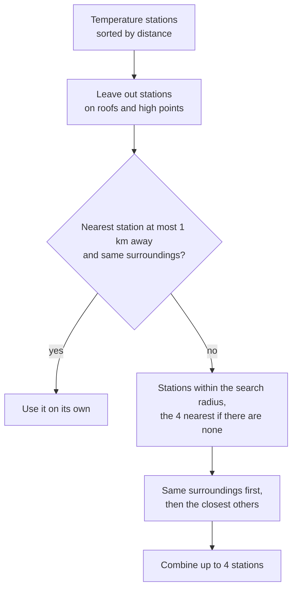

# Station recommendation

The network has more than 400 stations, many of them in street canyons, on roofs or in parks
only a few hundred metres apart. Their values differ, so the closest station is not always
the best one for your place.

## Stations

A station is a place with one or more sensor modules: temperature and humidity, often air
pressure and irradiance, and on some masts wind. Modules within 15 m of each other count as
one station. Each station has:

| Property | Source |
|---|---|
| Code, e.g. `0101-046` | Sensor names of the API |
| District | OpenStreetMap |
| Surroundings | Local Climate Zone from the city's metadata catalogue, otherwise from the global LCZ map |
| Roof or high point | Mounting zone and height above ground from the metadata catalogue |

Details: [Stations and reference data](../developer/reference-data.md).

## How the recommendation works

- Stations on roofs or high points measure other temperatures than at street level and are
  not recommended for temperature. You can still select them yourself; they are marked
  *roof/high point*.
- The wind station is the nearest station with a wind sensor, wherever it is mounted.
- The reason is shown with the recommendation: the nearest station fits, is too far away
  or has other surroundings.
- *Use the recommendation* is only offered if it fits the [API budget](api-limits.md), for
  example when other locations already use most of it.

## Choosing yourself

- **One station** gives exactly its values, including short local effects.
- **Several stations** give their median, which is steadier and closer to the typical value
  of the area. With 4 or more stations, outliers are left out.
- At most 6 stations per location; how many fit depends on the API budget.

## New stations

The city adds stations from time to time. When the daily station list contains stations
that are new within the last 30 days and part of the current recommendation for a location,
a repair issue suggests the new recommendation.

- The selection only changes if you apply the suggestion, because other stations change the
  values (jumps in long-term statistics) and the API budget.
- If you keep your stations, the suggestion is ignored. It only comes back for a different
  suggestion.
- No suggestion appears if the recommendation would not fit the API budget.

See [Repairs and troubleshooting](troubleshooting.md#new-stations-nearby).
