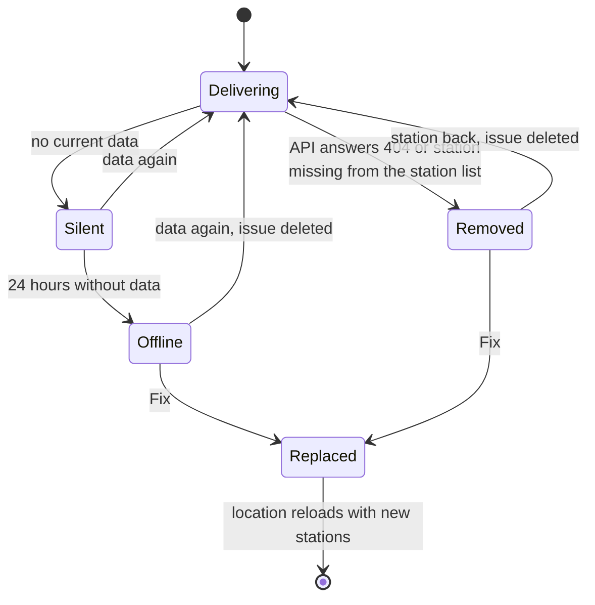
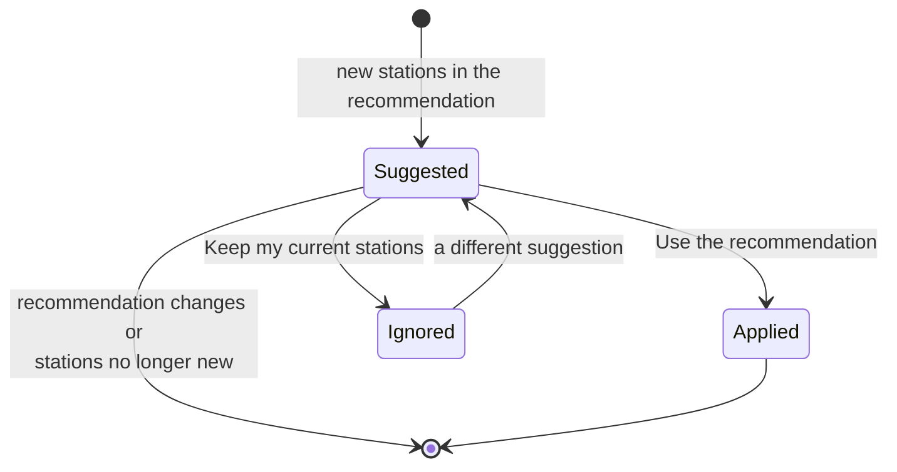

# Repairs and troubleshooting

## Repair issues

Problems you can fix appear under *Settings → System → Repairs*. Each issue has a *Fix*
button that leads through the solution.

| Issue | When | Fix |
|---|---|---|
| Station *X* sends no data | A selected station delivered no current data for 24 hours | Use the recommendation without this station, or choose from a list |
| Station *X* no longer exists | The API no longer knows a selected station | Use the recommendation without this station, or choose from a list |
| New stations near *location* | New stations are part of the recommendation, for 30 days after they appeared | Use the recommendation, or keep your stations |

While a station is missing, the other selected stations are still used. A broken station's
issue disappears by itself when the station delivers data again or when you no longer use
it. *Use the recommendation* is only offered if it fits the [API budget](api-limits.md).



### New stations nearby



Keeping your stations moves the issue to the ignored repairs, where you can still find it.
The same suggestion is not shown again.

## API outage or rate limit

There is no repair issue for this, because there is nothing you can fix:

1. Stations whose requests were skipped are fetched again shortly afterwards.
2. Without current data the entities keep their last values until the last measurement is
   60 minutes old, or three update intervals if that is longer.
3. Then the entities become unavailable until data arrives again.

A rate limit is logged once as a warning. If it happens often, other devices or scripts on
your internet connection probably use the API too; select fewer stations or a longer
interval.

Automations can react to an outage, for example with a push notification to your phone.
Adjust the entity and the notification service to your installation:

```yaml
alias: "Klimamessnetz: no temperature"
triggers:
  - trigger: state
    entity_id: sensor.seckenheim_temperature
    to: unavailable
    for:
      minutes: 30
actions:
  - action: notify.mobile_app_my_phone
    data:
      message: No temperature from Klimamessnetz Mannheim for 30 minutes.
```

## Messages

| Message | Meaning |
|---|---|
| There is no station within 10 km of this place. | Pick a place in or near Mannheim. |
| The station list could not be loaded from api.smartmannheim.de. | The API is unreachable and there is no stored station list yet. When adding a location, try again later; at startup Home Assistant retries by itself. |
| Too many API requests per hour. | The selection does not fit the budget. Select fewer stations, no wind station or a longer interval. |
| None of the selected stations exists any more. | All stations of the location are gone. Choose new ones under *Configure*. |
| The API request budget is used up for the moment. | The location retries by itself after the given time. |
| None of the selected stations delivered data in the last 40 minutes. | The entities are unavailable until data arrives. |

## Diagnostics and logs

- *Download diagnostics* on the integration entry contains the selected stations, the latest
  readings, the combined values and the state of the request budget. The coordinates of the
  location are removed.
- For details, enable *debug logging* on the integration entry, or permanently in
  `configuration.yaml`:

```yaml
logger:
  logs:
    custom_components.mannheim_climate: debug
```

When you [report a problem](https://github.com/CodeBrauer/ha-mannheim-climate/issues),
attach the diagnostics and the debug log.
